<!-- ═══════════════════════════  HEADER  ═══════════════════════════ -->

  

  

  
  
  

  

<!-- ═══════════════════════════  ABOUT  ═══════════════════════════ -->
<h2 align="center">👨‍💻 About Me · Men haqimda</h2>

<table align="center">
<tr>
<td width="50%" valign="top">

- 🚀 I build **web apps, REST APIs and business tools** — from idea to production
- ⚡ Favorite stack: **Laravel + Livewire + Vue.js**
- 🔭 Currently building **WebTech FaceID** at **WebTech**
- 🐍 Also working with **Python** and **Node.js**
- 💬 Ask me about **PHP, Laravel, Vue.js, JavaScript**
- 📫 Find me via the links below 👇

</td>
<td width="50%" valign="top">

- 🚀 **Veb-ilovalar, REST API va biznes tizimlar** yarataman — g'oyadan tayyor mahsulotgacha
- ⚡ Sevimli stack: **Laravel + Livewire + Vue.js**
- 🔭 Hozir **WebTech**'da **WebTech FaceID** ustida ishlayapman
- 🐍 **Python** va **Node.js** bilan ham ishlayman
- 💬 **PHP, Laravel, Vue.js, JavaScript** bo'yicha bemalol so'rang
- 📫 Pastdagi havolalar orqali bog'laning 👇

</td>
</tr>
</table>

<!-- ═══════════════════════════  TECH STACK  ═══════════════════════════ -->
<h2 align="center">🛠️ Tech Stack · Texnologiyalar</h2>

<b>Frontend</b>

  

<b>Backend · Database · Tools</b>

  

<!-- ═══════════════════════════  STATS  ═══════════════════════════ -->
<h2 align="center">📊 GitHub Stats · Statistika</h2>

  

  

<!-- ═══════════════════════════  CONNECT  ═══════════════════════════ -->
<h2 align="center">🤝 Connect · Bog'lanish</h2>

<!--
  ✏️ HAVOLALARINGIZNI SHU YERGA QO'YING:
  Har bir href="..." ichidagi manzilni o'zingizning havolangiz bilan almashtiring, masalan:
    Telegram  ->  https://t.me/username
    Instagram ->  https://www.instagram.com/username
    LinkedIn  ->  https://www.linkedin.com/in/username
-->

  
  
  

<!-- ═══════════════════════════  FOOTER  ═══════════════════════════ -->

  

